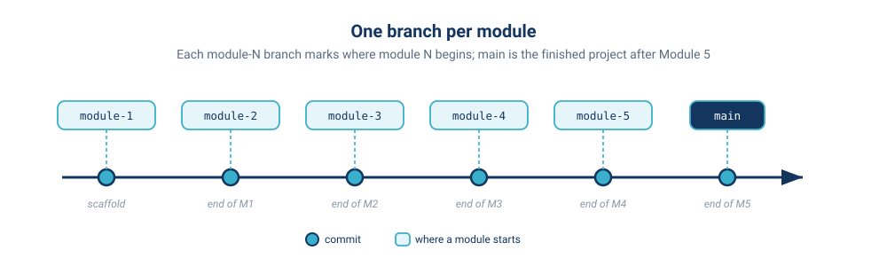

<p align="center">
  <picture>
    <source media="(prefers-color-scheme: dark)" srcset="docs/images/DVC_by_lakeFS_horizontal_logo.svg">
    
  </picture>
</p>

# Reproducible ML with DVC by lakeFS

This course teaches [DVC](https://dvc.org) 3.x through one small ML project, a churn model for a retail bank, that you build up over five modules.
You version the dataset and the model, then turn the training script into a reproducible pipeline.
After that you run and compare experiments with MLflow tracking, set the project up for a team with shared storage and CI, and in the last module move it to [lakeFS](https://lakefs.io).
All of it runs on a laptop. You do not need a GPU or a cluster.

Before starting, read the Requirements, Setup, and Storage sections below.
You need Python 3.12 or newer, Git, and uv. DVC also needs somewhere to push data, which can be your own S3 bucket or a local folder. Docker is only used in Module 5, and on macOS there is one extra install before XGBoost can import.

## Project

The dataset is the public [Bank Customer Churn dataset](https://www.kaggle.com/datasets/gauravtopre/bank-customer-churn-dataset): 10,000 bank customers, 20.4% of whom left.
The first model is a scikit-learn RandomForest with F1 around 0.56. By the end of Module 3 a grid search has replaced it with a tuned XGBoost at F1 0.59.
Training runs as a four-stage DVC pipeline, `prepare`, `featurize`, `train`, `evaluate`, and from Module 3 on every run is also logged to a local MLflow.

## Modules

| # | Module | What you have at the end |
|---|--------|--------------------|
| 1 | [Foundations and versioning data/models](docs/module-1/README.md) | Data and a model tracked with DVC |
| 2 | [Reproducible ML pipelines](docs/module-2/README.md) | The trainer split into a cached `dvc.yaml` pipeline |
| 3 | [Options for experiments, metrics, and plots](docs/module-3/README.md) | MLflow logging, DVC experiments, and the selected XGBoost run |
| 4 | [Collaboration and automation](docs/module-4/README.md) | Shared DVC storage, registries, and pull-request checks |
| 5 | [From DVC to lakeFS](docs/module-5/README.md) | A local lakeFS repo holding the project's data and model |

## Branches

You build the project yourself. The branches mark where each module starts and nothing more.
`module-1` is the initial scaffold. It has no `.dvc/` directory yet because running `dvc init` is part of Module 1.
Each later branch is the previous module finished. For example, `module-3` is the project as it stands when Module 2 is done.
If you work straight through, you never switch branches after `module-1`. Module 5 fetches three files with `git checkout main -- <paths>`, but you stay on your own branch even there.
The branches are there for anyone joining mid-course, or for starting a module over from a known state.
`main` is the finished project and the answer key. Running `git diff module-2 module-3`, for example, shows everything Module 2 builds.
The walkthroughs in [`docs/`](docs/) are identical on every branch.
Commit your own work as you go.

<p align="center">  </p>

## Requirements

| Requirement | Note |
|-------------|------|
| Python 3.12+ | Use the same interpreter for the venv |
| Git | Needed for branches and commits |
| [uv](https://docs.astral.sh/uv/) | `curl -LsSf https://astral.sh/uv/install.sh \| sh` or `brew install uv` |
| macOS OpenMP | `brew install libomp` before the XGBoost module |
| DVC remote storage | Your own S3 bucket, or a local folder |
| Docker | Module 5 only |
| lakectl | Module 5 only: `brew install lakefs`, or the [lakeFS release binaries](https://github.com/treeverse/lakeFS/releases) |
| VS Code extension | Optional: [lakeFS DVC pack](https://marketplace.visualstudio.com/items?itemName=lakeFS.lakefs-dvc-pack) |

## Setup

```bash
# 1. Clone and enter the repo
git clone <url of this repo> dvc-course && cd dvc-course

# 2. Create and activate a virtual environment
uv venv
source .venv/bin/activate        # Windows: .venv\Scripts\activate

# 3. Install pinned dependencies (this installs DVC too)
uv pip install -r requirements.txt

# 4. Check that DVC is on your PATH
dvc --version
```

```bash
# macOS, before Module 3
brew install libomp
```

## Storage

| Note |
|------|
| The demo bucket `s3://dvc-course-bucket` is private, so you cannot pull from it or push to it. |
| You never need its contents: `dvc get git@github.com:alex000kim/dvc_course.git .data/churn.csv -o data/raw/churn.csv` restores the raw data, `dvc repro` rebuilds the rest. |
| Use your own S3 bucket if you have one. If you do not, a local folder works as a DVC remote. |
| There is nothing to configure yet. [Module 1](docs/module-1/README.md) covers the DVC remote options. |

## Start

```bash
git checkout module-1
```

Continue with [Module 1](docs/module-1/README.md).
