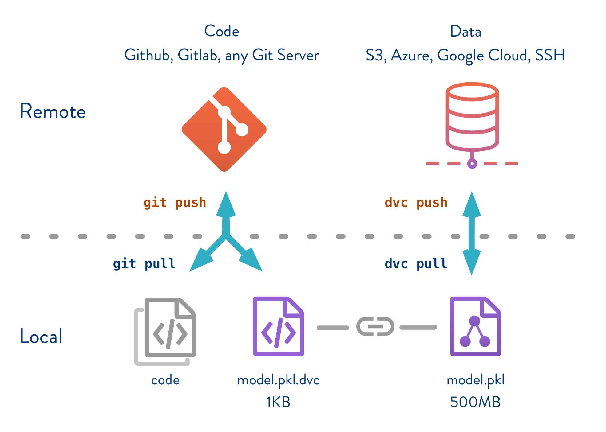
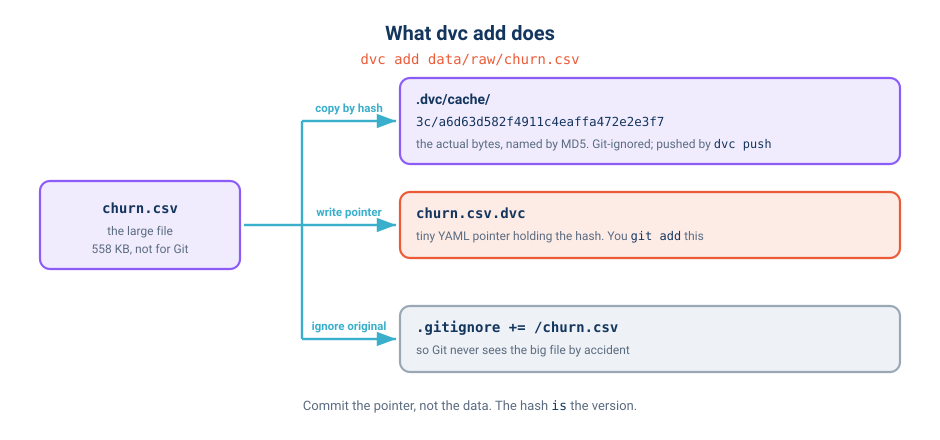

# Module 1: Foundations and Versioning Data and Models

In this module you add DVC to a repo that so far only uses Git. You initialize DVC, track the dataset and a baseline model, push both to a remote, and switch between two versions of the data. The `module-1` branch has no `.dvc/` directory on purpose, because creating it is part of the module.

| Checkpoint | What happens |
|------------|--------------|
| Start | `module-1` has dependencies, but no DVC repo and no data |
| Raw data | `data/raw/churn.csv`, 10,000 rows, about 549 KB |
| First model | `models/model.pkl`, RandomForest, F1 about 0.56 |
| Remote | Your S3 bucket or a local folder |
| Version switch | Make an 8k-row version, then return to the full file |



| Setup |
|-------|
| Skip this if the top-level venv is already active. |

```bash
uv venv
source .venv/bin/activate          # Windows: .venv\Scripts\activate
uv pip install -r requirements.txt
dvc --version                      # confirms DVC is installed and on PATH
```

```bash
brew install libomp                # macOS only; Linux/Windows wheels bundle it
```

| Layout |
|--------|
| This is the layout you end up with. `data/raw/` and `models/` do not exist on the branch yet. The commands below create them. |

```text
.
├── data/raw/          # inputs, tracked by DVC (created by dvc get)
├── models/            # trained models, tracked by DVC (created by the trainer)
├── src/               # code, tracked by Git
├── requirements.txt   # pinned dependencies
└── docs/              # these walkthroughs
```

| Raw data |
|----------|
| Fetch the churn CSV with `dvc get`. It downloads a file from any Git or DVC repository without tracking it, and works before `dvc init`. Here the source is this course repo, which keeps a copy under `.data/`. |

```bash
dvc get https://github.com/treeverse/dvc_course .data/churn.csv -o data/raw/churn.csv
```

```bash
wc -l data/raw/churn.csv          # 10,001 lines (10k rows + header)
head -3 data/raw/churn.csv
```

| DVC init |
|----------|
| Run at the repo root. Commit DVC's project files before adding data. |

```bash
# if you switched to `module-1` from `main`, 
# we need to remove `.dvc/` folder
# to be able to start from scratch
rm -rf .dvc/

dvc init
```

```bash
git status
git commit -m "Initialize DVC"
```

| Track the CSV |
|---------------|
| After this, the pointer file and an ignore entry are in Git, and the actual bytes are in the DVC cache. |

```bash
dvc add data/raw/churn.csv
```

```bash
cat data/raw/churn.csv.dvc
```

```yaml
outs:
- md5: cf87506c5be947a5cda69511b2bf3ef3
  size: 561600
  hash: md5
  path: churn.csv
```



| Data status |
|-------------|
| `dvc data status` does for DVC-tracked files what `git status` does for the rest of the repo. At this point the data is in the cache but the pointer is not committed to Git yet. |

```bash
dvc data status
```

```text
DVC committed changes:
  (git commit the corresponding dvc files to update the repo)
        added: data/raw/churn.csv
```

```bash
git add data/raw/churn.csv.dvc data/raw/.gitignore
git commit -m "Track raw churn dataset with DVC"
dvc data status                    # No changes.
```

| Baseline model |
|----------------|
| Run the starter trainer, then track the pickle the same way as the CSV. |

```bash
python src/train_baseline.py
```

```text
F1:      0.564
ROC-AUC: 0.848
Saved model to models/model.pkl
```

```bash
dvc add models/model.pkl
git add models/model.pkl.dvc models/.gitignore
git commit -m "Add baseline model tracked with DVC"
```

| Remote |
|--------|
| A fresh `dvc init` has no remote configured. Add one with the `-d` flag so it becomes the default for `dvc push` and `dvc pull`. |
| If you have no S3 access, [Google Cloud Storage](https://dvc.org/doc/user-guide/data-management/remote-storage/google-cloud-storage), [Azure Blob Storage](https://dvc.org/doc/user-guide/data-management/remote-storage/azure-blob-storage), and [S3-compatible servers like MinIO](https://dvc.org/doc/user-guide/data-management/remote-storage/amazon-s3#s3-compatible-servers-non-amazon) are set up the same way. The URL and the credentials are the only differences. |

```bash
# Option A: your own S3 bucket. Pick either this block or the next one.
# Needs AWS credentials, via `aws configure` or the standard
# AWS_ACCESS_KEY_ID / AWS_SECRET_ACCESS_KEY environment variables.
dvc remote add -d storage s3://YOUR-BUCKET/dvc-course
git add .dvc/config
git commit -m "Point DVC remote at my bucket"
```

```bash
# Option B: no cloud account, use a local folder as the remote.
dvc remote add -d storage /tmp/dvc-course-remote
git add .dvc/config
git commit -m "Point DVC remote at a local folder"
```

```bash
dvc remote list
dvc push
```

| Later checkouts |
|-----------------|
| The reference branches (`module-2` and later, and `main`) come with a `storage` remote that points at the private demo bucket. After a fresh checkout of any of them, repoint it: `dvc remote modify storage url s3://YOUR-BUCKET/dvc-course` (or your local folder path). |

| Pull check |
|------------|
| Inside this repo DVC may restore the files from the local cache. In a fresh clone it would have to fetch them from the remote. |

```bash
rm -f data/raw/churn.csv models/model.pkl
dvc pull
```

| Version switch |
|----------------|
| The 8k-row commit is temporary, and by the end of this section you are back on the full 10k rows. |

```bash
head -n 8001 data/raw/churn.csv > /tmp/churn-8k.csv   # header + first 8,000 rows
mv /tmp/churn-8k.csv data/raw/churn.csv
dvc data status
```

```text
DVC uncommitted changes:
  (use "dvc commit <file>..." to track changes)
  (use "dvc checkout <file>..." to discard changes)
        modified: data/raw/churn.csv
```

```bash
dvc add data/raw/churn.csv
git add data/raw/churn.csv.dvc
git commit -m "Switch to 8k-row extract"
dvc push
```

```bash
git checkout HEAD~1 data/raw/churn.csv.dvc
dvc checkout data/raw/churn.csv
wc -l data/raw/churn.csv          # back to 10,001 lines (10k rows + header)
```

```bash
git reset --hard HEAD~1            # discard the "8k-row extract" commit
dvc checkout data/raw/churn.csv    # restore the 10k data to match
wc -l data/raw/churn.csv           # 10,001 again; don't skip this check
```

| Command | What it does |
|---------|------|
| [`dvc get <repo> <path>`](https://dvc.org/doc/command-reference/get) | Download a file from a Git or DVC repo, untracked |
| [`dvc init`](https://dvc.org/doc/command-reference/init) | Set up DVC in a Git repo |
| [`dvc add <path>`](https://dvc.org/doc/command-reference/add) | Start tracking a file/dir, write a `.dvc` pointer |
| [`dvc data status`](https://dvc.org/doc/command-reference/data/status) | Show tracked files that changed, like `git status` |
| [`dvc remote add -d <name> <url>`](https://dvc.org/doc/command-reference/remote/add) | Add a default remote |
| [`dvc remote modify <name> url <url>`](https://dvc.org/doc/command-reference/remote/modify) | Change a remote's location |
| [`dvc push`](https://dvc.org/doc/command-reference/push) / [`dvc pull`](https://dvc.org/doc/command-reference/pull) | Upload / download tracked data to/from the remote |
| [`dvc checkout`](https://dvc.org/doc/command-reference/checkout) | Sync workspace files to match the `.dvc` pointers |

Next: [Module 2](../module-2/README.md).
