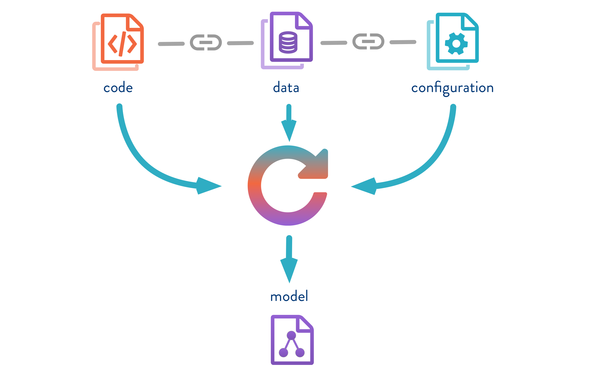
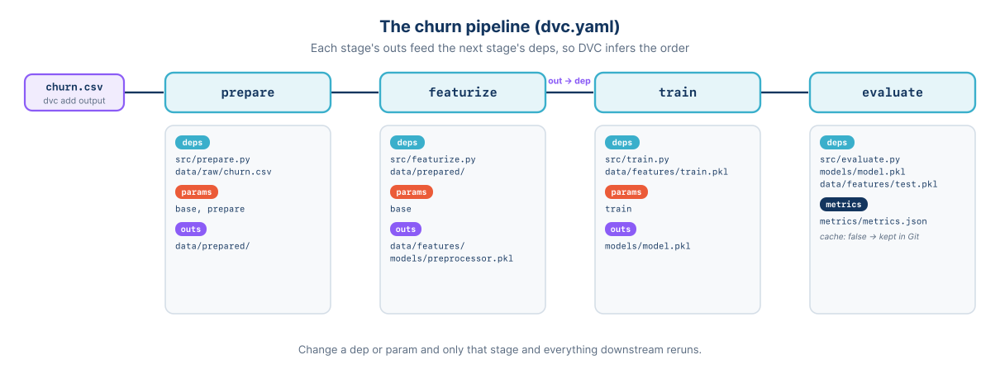
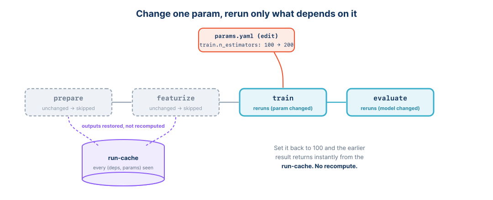

# Module 2: Reproducible ML Pipelines

This module replaces the standalone training script with a four-stage DVC pipeline. The model stays the same, but each step is now declared in `dvc.yaml`, so a single command reruns only the stages whose inputs changed. You create six files by copy-paste, and each one is shown in full below with its path. If `git rm src/train_baseline.py` in the first step says the file is already gone, you started from the wrong branch, so check the table below first.

| Start state | Check |
|-------------|-------|
| Continue from Module 1 | Raw CSV already tracked by DVC |
| Or `git checkout module-2` | Configure your remote and pull the CSV |
| No remote yet | `dvc get git@github.com:alex000kim/dvc_course.git .data/churn.csv -o data/raw/churn.csv` restores the raw input |

| Cleanup |
|---------|
| From here on `models/model.pkl` is produced by the pipeline instead of being tracked through its own `.dvc` file, so the old pointer has to go. |

```bash
git rm src/train_baseline.py
dvc remove models/model.pkl.dvc
rm -f models/model.pkl
```

| Pipeline overview |
|-------------------|
| There are four scripts that pass data to each other through files. DVC tracks the deps, outs, and params each one declares. |



```text
prepare -> featurize -> train -> evaluate
```

| File | Role |
|------|------|
| `src/prepare.py` | Clean and split raw CSV |
| `src/featurize.py` | Fit preprocessor and write feature pickles |
| `src/train.py` | Fit classifier |
| `src/evaluate.py` | Write metrics |

_Note_: if you don't want to copy-paste contents for each file below, you can simply checkout these files from this module's end state (the `module-3` branch):
```
git checkout origin/module-3 -- src/prepare.py src/featurize.py src/train.py src/evaluate.py
```
if you do that, please spend a bit of time exploring the contents of the files just to have a better understanding of what's inside.

| Create `src/prepare.py` |
|-------------------------|

<details>
<summary>Show <code>src/prepare.py</code></summary>

```python
"""Stage 1 (prepare): clean the raw data and split it into train and test.

Reads:  data/raw/churn.csv
Writes: data/prepared/train.csv, data/prepared/test.csv
Params: base.*, prepare.*
"""

from pathlib import Path

import pandas as pd
import yaml
from sklearn.model_selection import train_test_split

RAW = "data/raw/churn.csv"
OUT_DIR = Path("data/prepared")


def main() -> None:
    params = yaml.safe_load(open("params.yaml"))
    base, prep = params["base"], params["prepare"]

    df = pd.read_csv(RAW)
    df = df.drop(columns=base["drop"])

    train, test = train_test_split(
        df,
        test_size=prep["test_size"],
        random_state=prep["random_state"],
        stratify=df[base["target"]],
    )

    OUT_DIR.mkdir(parents=True, exist_ok=True)
    train.to_csv(OUT_DIR / "train.csv", index=False)
    test.to_csv(OUT_DIR / "test.csv", index=False)
    print(f"prepare: {len(train):,} train / {len(test):,} test rows")


if __name__ == "__main__":
    main()
```

</details>

| Create `src/featurize.py` |
|---------------------------|

<details>
<summary>Show <code>src/featurize.py</code></summary>

```python
"""Stage 2 (featurize): fit a preprocessor on train, transform train and test.

Impute + scale numeric columns, one-hot encode categoricals. The fitted
transformer is saved so the same features can be produced at inference time.

Reads:  data/prepared/train.csv, data/prepared/test.csv
Writes: data/features/train.pkl, data/features/test.pkl, models/preprocessor.pkl
Params: base.*
"""

import pickle
from pathlib import Path

import pandas as pd
import yaml
from sklearn.compose import ColumnTransformer
from sklearn.impute import SimpleImputer
from sklearn.pipeline import Pipeline
from sklearn.preprocessing import OneHotEncoder, StandardScaler

PREPARED = Path("data/prepared")
FEATURES = Path("data/features")
PREPROCESSOR = Path("models/preprocessor.pkl")


def build_preprocessor(numeric, categorical) -> ColumnTransformer:
    numeric_pipe = Pipeline(
        [("impute", SimpleImputer(strategy="median")), ("scale", StandardScaler())]
    )
    return ColumnTransformer(
        [
            ("num", numeric_pipe, numeric),
            ("cat", OneHotEncoder(handle_unknown="ignore"), categorical),
        ]
    )


def main() -> None:
    base = yaml.safe_load(open("params.yaml"))["base"]
    target, categorical = base["target"], base["categorical"]

    train = pd.read_csv(PREPARED / "train.csv")
    test = pd.read_csv(PREPARED / "test.csv")

    y_train, y_test = train.pop(target), test.pop(target)
    numeric = [c for c in train.columns if c not in categorical]

    pre = build_preprocessor(numeric, categorical)
    X_train = pre.fit_transform(train)
    X_test = pre.transform(test)

    FEATURES.mkdir(parents=True, exist_ok=True)
    PREPROCESSOR.parent.mkdir(parents=True, exist_ok=True)
    with open(FEATURES / "train.pkl", "wb") as f:
        pickle.dump((X_train, y_train.to_numpy()), f)
    with open(FEATURES / "test.pkl", "wb") as f:
        pickle.dump((X_test, y_test.to_numpy()), f)
    with open(PREPROCESSOR, "wb") as f:
        pickle.dump(pre, f)
    print(f"featurize: {X_train.shape[1]} features")


if __name__ == "__main__":
    main()
```

</details>

| Create `src/train.py` |
|-----------------------|

<details>
<summary>Show <code>src/train.py</code></summary>

```python
"""Stage 3 (train): fit a classifier on the training features.

The model type and hyperparameters come from params.yaml, which is what lets
Module 3 run experiments by overriding parameters.

Reads:  data/features/train.pkl
Writes: models/model.pkl
Params: train.*
"""

import pickle
from pathlib import Path

import yaml

MODEL_OUT = Path("models/model.pkl")


def build_classifier(p: dict):
    max_depth = p["max_depth"] or None  # 0 -> None
    if p["model_type"] == "xgboost":
        from xgboost import XGBClassifier

        return XGBClassifier(
            n_estimators=p["n_estimators"],
            max_depth=max_depth or 6,
            learning_rate=p["learning_rate"],
            random_state=p["random_state"],
            eval_metric="logloss",
        )
    if p["model_type"] == "randomforest":
        from sklearn.ensemble import RandomForestClassifier

        return RandomForestClassifier(
            n_estimators=p["n_estimators"],
            max_depth=max_depth,
            random_state=p["random_state"],
            n_jobs=-1,
        )
    raise ValueError(f"Unknown model_type: {p['model_type']}")


def main() -> None:
    p = yaml.safe_load(open("params.yaml"))["train"]
    with open("data/features/train.pkl", "rb") as f:
        X_train, y_train = pickle.load(f)

    model = build_classifier(p)
    model.fit(X_train, y_train)

    MODEL_OUT.parent.mkdir(parents=True, exist_ok=True)
    with open(MODEL_OUT, "wb") as f:
        pickle.dump(model, f)
    print(f"train: fit {p['model_type']} on {X_train.shape[0]:,} rows")


if __name__ == "__main__":
    main()
```

</details>

| Create `src/evaluate.py` |
|--------------------------|

<details>
<summary>Show <code>src/evaluate.py</code></summary>

```python
"""Stage 4 (evaluate): score the model on the held-out test set.

Reads:  models/model.pkl, data/features/test.pkl
Writes: metrics/metrics.json
"""

import json
import pickle
from pathlib import Path

from sklearn.metrics import f1_score, roc_auc_score

METRICS_OUT = Path("metrics/metrics.json")


def main() -> None:
    with open("models/model.pkl", "rb") as f:
        model = pickle.load(f)
    with open("data/features/test.pkl", "rb") as f:
        X_test, y_test = pickle.load(f)

    preds = model.predict(X_test)
    probs = model.predict_proba(X_test)[:, 1]
    metrics = {
        "f1": round(float(f1_score(y_test, preds)), 4),
        "roc_auc": round(float(roc_auc_score(y_test, probs)), 4),
    }

    METRICS_OUT.parent.mkdir(parents=True, exist_ok=True)
    with open(METRICS_OUT, "w") as f:
        json.dump(metrics, f, indent=2)
    print(f"evaluate: {metrics}")


if __name__ == "__main__":
    main()
```

</details>

| Create `params.yaml` |
|----------------------|
| A change to `train.n_estimators` should only invalidate `train` and `evaluate`, and leave `prepare` alone. |

```yaml
base:
  target: churn
  categorical: [country, gender]
  drop: [customer_id]

prepare:
  test_size: 0.2
  random_state: 42

train:
  model_type: randomforest   # randomforest | xgboost
  n_estimators: 100
  max_depth: 0               # 0 means "no limit" (None)
  learning_rate: 0.1         # used by xgboost only
  random_state: 42
```

or run below to get a complete file from `module-3`:
```
git checkout origin/module-3 -- params.yaml
```

| Create `dvc.yaml` |
|-------------------|
| The raw CSV is a dependency of the first stage rather than an output of any stage. `metrics/metrics.json` is tiny, so it is kept in Git instead of the cache. |

<details>
<summary>Show <code>dvc.yaml</code></summary>

```yaml
stages:
  prepare:
    cmd: python src/prepare.py
    deps:
      - src/prepare.py
      - data/raw/churn.csv
    params:
      - base
      - prepare
    outs:
      - data/prepared

  featurize:
    cmd: python src/featurize.py
    deps:
      - src/featurize.py
      - data/prepared
    params:
      - base
    outs:
      - data/features
      - models/preprocessor.pkl

  train:
    cmd: python src/train.py
    deps:
      - src/train.py
      - data/features/train.pkl
    params:
      - train
    outs:
      - models/model.pkl

  evaluate:
    cmd: python src/evaluate.py
    deps:
      - src/evaluate.py
      - models/model.pkl
      - data/features/test.pkl
    metrics:
      - metrics/metrics.json:
          cache: false
```

</details>

or run below to get a complete file from `module-3`:
```
git checkout origin/module-3 -- dvc.yaml
```



| Build once |
|------------|
| On the first `dvc repro` all four stages run and F1 matches the Module 1 baseline. The transcripts here are trimmed to the interesting lines, so yours prints a few more. |

```bash
dvc repro
```

```text
Running stage 'prepare':
prepare: 8,000 train / 2,000 test rows
Running stage 'featurize':
featurize: 13 features
Running stage 'train':
train: fit randomforest on 8,000 rows
Running stage 'evaluate':
evaluate: {'f1': 0.5639, 'roc_auc': 0.8483}
```

```bash
dvc dag
```

```text
 +------------------------+  
 | data/raw/churn.csv.dvc |  
 +------------------------+  
              *              
              *              
              *              
         +---------+         
         | prepare |         
         +---------+         
              *              
              *              
              *              
        +-----------+        
        | featurize |        
        +-----------+        
         **        **        
       **            *       
      *               **     
+-------+               *    
| train |             **     
+-------+            *       
         **        **        
           **    **          
             *  *            
        +----------+         
        | evaluate |         
        +----------+  
```

| Rerun check |
|-------------|
| Run `dvc repro` a second time and every stage is skipped. |

```bash
dvc repro
```

```text
Stage 'prepare' didn't change, skipping
Stage 'featurize' didn't change, skipping
Stage 'train' didn't change, skipping
Stage 'evaluate' didn't change, skipping
Data and pipelines are up to date.
```

```bash
dvc repro --dry              # optional: show what WOULD run first
```

```bash
# edit params.yaml first: train.n_estimators: 200
dvc status                   # train and evaluate are out of date, nothing else
dvc repro

# set train.n_estimators back to 100, then run again
dvc repro                    # prints "Stage 'train' is cached" because the 100-tree
                             # model comes back from the run cache without retraining
```



| Commit |
|--------|
| Commit scripts, metadata, params, metrics, and the cleanup from the first step. |

```bash
git add dvc.yaml dvc.lock params.yaml src/ metrics/metrics.json data/.gitignore models/.gitignore models/model.pkl.dvc
git commit -m "Add four-stage churn pipeline"
dvc push
```

| Command | What it does |
|---------|------|
| [`dvc repro`](https://dvc.org/doc/command-reference/repro) | Run the pipeline, skipping stages whose inputs did not change |
| [`dvc repro --dry`](https://dvc.org/doc/command-reference/repro) | Show what would run without running it |
| [`dvc dag`](https://dvc.org/doc/command-reference/dag) | Print the stage dependency graph |
| [`dvc remove <file>.dvc`](https://dvc.org/doc/command-reference/remove) | Stop tracking a `dvc add` output |
| [`dvc status`](https://dvc.org/doc/command-reference/status) | Show which stages are out of date |

Next: [Module 3](../module-3/README.md).
