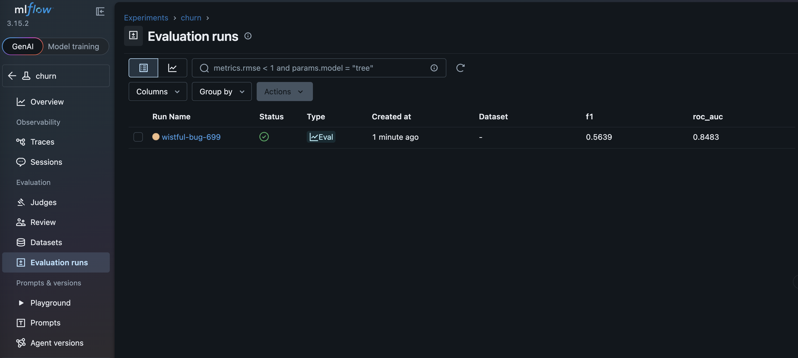
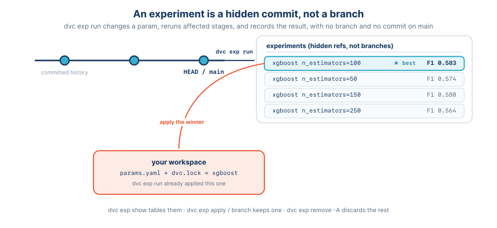
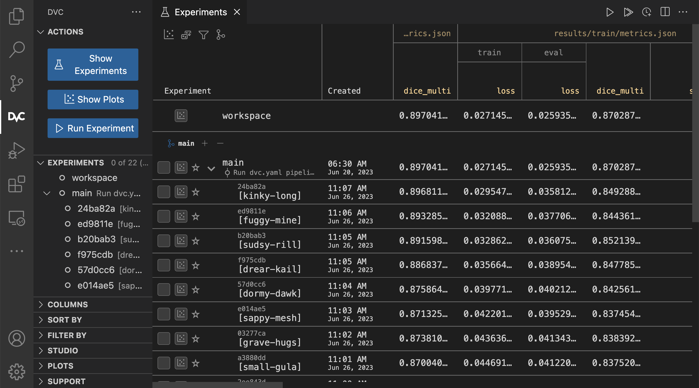

# Module 3: Options for Experiments, Metrics, and Plots

This module adds run tracking. The pipeline logs each run to a local MLflow, and `dvc exp run` records whole-pipeline experiments that you can queue up, compare in a table, and apply back to the workspace. Check the dataset before you start. If the 8k extract from Module 1 is still checked out, none of the numbers below will match.

| Start state | Check |
|-------------|-------|
| Continue from Module 2 | Four-stage RandomForest pipeline |
| Or `git checkout module-3` | Point `storage` at your remote (Module 1, "Later checkouts"), then `dvc pull`; or `dvc get https://github.com/treeverse/dvc_course .data/churn.csv -o data/raw/churn.csv && dvc repro` |
| Baseline | F1 0.5639 |
| First sanity check | `wc -l data/raw/churn.csv` must be 10,001 |
| macOS | `brew install libomp` once, or the XGBoost runs below fail to import |

| Existing metrics |
|------------------|
| Module 2 already marked `metrics/metrics.json` as a DVC metric. |

```bash
dvc metrics show
```

```text
Path                  f1      roc_auc
metrics/metrics.json  0.5639  0.8483
```

| MLflow |
|--------|
| Use an absolute tracking URI, set from the repo root. Every new shell needs the export again. |

```bash
export MLFLOW_TRACKING_URI="sqlite:///$PWD/mlflow.db"
```

| Replace `src/evaluate.py` |
|---------------------------|
| Replace the whole file. This version takes over from the Module 2 one. |

<details>
<summary>Show <code>src/evaluate.py</code></summary>

```python
"""Stage 4 (evaluate): score the model, write metrics, and log the run to MLflow.

DVC reads its metrics (`dvc metrics show`, `dvc exp show`) from
metrics/metrics.json, a plain file in the repo. The same params and metrics,
plus the plots, are also logged to MLflow so you can browse and compare runs in
its local UI (`mlflow ui`).

Reads:  models/model.pkl, data/features/test.pkl
Writes: metrics/metrics.json, plus MLflow tracking data (gitignored)
"""

import json
import pickle
from pathlib import Path

import mlflow
import yaml
from sklearn.metrics import (
    ConfusionMatrixDisplay,
    RocCurveDisplay,
    f1_score,
    roc_auc_score,
)

METRICS_OUT = Path("metrics/metrics.json")


def main() -> None:
    with open("models/model.pkl", "rb") as f:
        model = pickle.load(f)
    with open("data/features/test.pkl", "rb") as f:
        X_test, y_test = pickle.load(f)

    preds = model.predict(X_test)
    probs = model.predict_proba(X_test)[:, 1]
    metrics = {
        "f1": round(float(f1_score(y_test, preds)), 4),
        "roc_auc": round(float(roc_auc_score(y_test, probs)), 4),
    }

    METRICS_OUT.parent.mkdir(parents=True, exist_ok=True)
    with open(METRICS_OUT, "w") as f:
        json.dump(metrics, f, indent=2)

    # Log the same run to MLflow. Swapping trackers (W&B, Neptune, ...) means
    # changing only this import and these log calls.
    mlflow.set_experiment("churn")
    with mlflow.start_run():
        mlflow.log_params(yaml.safe_load(open("params.yaml"))["train"])
        mlflow.log_metrics(metrics)
        cm = ConfusionMatrixDisplay.from_predictions(y_test, preds)
        mlflow.log_figure(cm.figure_, "confusion_matrix.png")
        roc = RocCurveDisplay.from_predictions(y_test, probs)
        mlflow.log_figure(roc.figure_, "roc_curve.png")

    print(f"evaluate: {metrics}")


if __name__ == "__main__":
    main()
```

</details>

or run below to get a complete file from `module-4`:
```
git checkout origin/module-4 -- src/evaluate.py
```

| Reproduce |
|-----------|
| Only `evaluate` should rerun after the logging change. |

```bash
dvc repro
```

```text
Running stage 'evaluate':
evaluate: {'f1': 0.5639, 'roc_auc': 0.8483}
```

```bash
mlflow ui
```

| UI check | Commit |
|----------|--------|
| Open http://127.0.0.1:5000 and inspect the `churn` run. Stop with Ctrl-C. | `git add src/evaluate.py dvc.lock` |



```bash
git add src/evaluate.py dvc.lock
git commit -m "Log runs to MLflow"
```

| Other trackers |
|----------------|
| W&B would replace the MLflow block with `wandb.init(project="churn")` and `wandb.log({...})`. |

| One experiment |
|----------------|
| Use `dvc repro` for ordinary pipeline edits, and `dvc exp run` when you want the run recorded so you can compare it later. |

```bash
dvc exp run -S train.model_type=xgboost
```

| Expected | Storage |
|----------|---------|
| F1 near 0.583 | A hidden Git ref that does not show up in `git branch` |



| Queue |
|-------|
| Three estimator values times two learning rates gives six runs. All six are XGBoost because the `-S train.model_type=xgboost` run above left that value in your workspace `params.yaml`, and queued runs start from the workspace. Re-export `MLFLOW_TRACKING_URI` first if needed. |

```bash
dvc exp run --queue -S 'train.n_estimators=50,100,200' -S 'train.learning_rate=0.05,0.2'
dvc queue start
dvc queue status
```

| Compare |
|---------|
| DVC generates the experiment names on your machine, so yours will differ from the sample below, and the second row is labeled with your current branch. Look for the row with F1 0.5891. |

```bash
dvc exp show --sort-by f1 --sort-order desc
```

```text
Experiment        f1       roc_auc   train.model_type   train.n_estimators   train.learning_rate
workspace         0.583    0.8591    xgboost            100                  0.1
module-3          0.5639   0.8483    randomforest       100                  0.1
├── leery-gash    0.5891   0.8581    xgboost            50                   0.2
├── tined-eyry    0.586    0.8623    xgboost            100                  0.05
├── flamy-gaol    0.583    0.8591    xgboost            100                  0.1
├── fetid-heel    0.5825   0.8439    xgboost            100                  0.2
├── slimy-trio    0.5823   0.8575    xgboost            200                  0.05
├── beige-rins    0.576    0.8624    xgboost            50                   0.05
└── riled-cony    0.5581   0.8302    xgboost            200                  0.2
```

```bash
dvc exp diff flamy-gaol leery-gash   # substitute two of YOUR experiment names
```

```bash
dvc exp apply leery-gash             # YOUR name for the F1 0.5891 row
```

```bash
dvc metrics show
git add params.yaml dvc.lock metrics/metrics.json
git commit -m "Adopt tuned XGBoost as the model"
dvc push                             # the tuned model; Module 4 pulls it from your remote
```

| Cleanup |
|---------|
| If you want to keep working on an experiment, turn it into a branch with `dvc exp branch <exp-name> <branch>`. Once old experiments only clutter the table, `dvc exp remove -A` deletes them. |

| VS Code |
|---------|
| The lakeFS DVC pack adds an experiment table inside VS Code. |

```json
{
  "recommendations": [
    "lakeFS.lakefs-dvc-pack",
    "ms-python.python"
  ]
}
```

```bash
git add .vscode/extensions.json
git commit -m "add DVC extension"
```



| (Optional) Try DVCLive - an experiment tracking framework from DVC's ecosystem |
|---------|
| DVCLive is already installed and writes to plain files. The rest of this repo does not use it. |
| It also ships logger callbacks for common ML frameworks (Keras, PyTorch Lightning, Hugging Face, and more); see [ML Frameworks](https://dvc.org/doc/dvclive/ml-frameworks) for the current list. |

```python
from dvclive import Live

with Live(dvcyaml=False) as live:
    live.log_metric("f1", f1, plot=False)
    live.log_sklearn_plot("confusion_matrix", y_test, preds)
```

| Command | What it does |
|---------|------|
| [`dvc metrics show`](https://dvc.org/doc/command-reference/metrics/show) / [`diff`](https://dvc.org/doc/command-reference/metrics/diff) | Print / diff the pipeline's metrics file |
| [`mlflow ui`](https://mlflow.org/docs/latest/tracking.html) | Browse tracked runs at http://127.0.0.1:5000 |
| [`dvc exp run -S <param>=<value>`](https://dvc.org/doc/command-reference/exp/run) | Run one experiment with an override |
| [`dvc exp run --queue`](https://dvc.org/doc/command-reference/exp/run) / [`dvc queue start`](https://dvc.org/doc/command-reference/queue/start) | Queue experiments and run them |
| [`dvc queue status`](https://dvc.org/doc/command-reference/queue/status) | Check on queued runs |
| [`dvc exp show`](https://dvc.org/doc/command-reference/exp/show) | Compare all experiments in a table |
| [`dvc exp diff`](https://dvc.org/doc/command-reference/exp/diff) | Diff params/metrics between two experiments |
| [`dvc exp apply`](https://dvc.org/doc/command-reference/exp/apply) / [`dvc exp branch`](https://dvc.org/doc/command-reference/exp/branch) | Keep an experiment's result |
| [`dvc exp remove -A`](https://dvc.org/doc/command-reference/exp/remove) | Delete experiments |

Next: [Module 4](../module-4/README.md).
