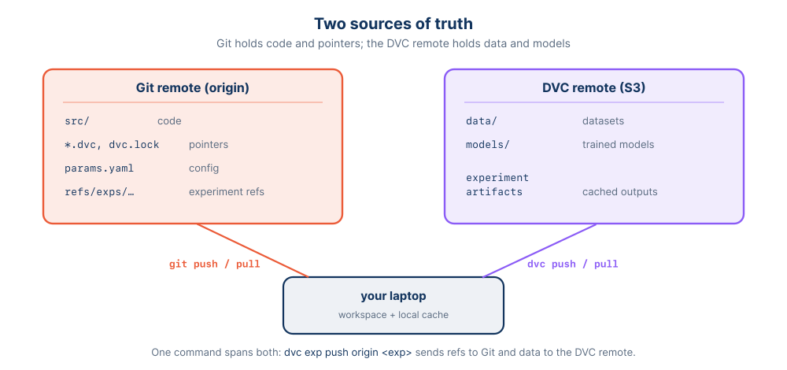
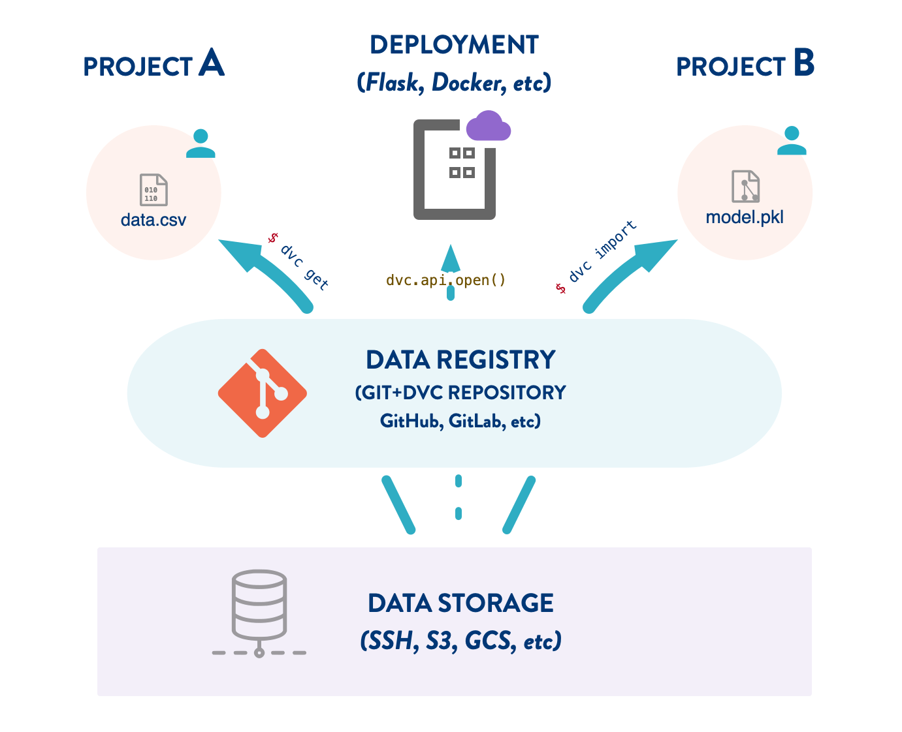

# Module 4: Collaboration, Data Registries, and Automation

This module is about working on the project with other people. You clone and rebuild it on a second machine, share experiments, reuse datasets through a registry, and reproduce the pipeline in CI on every pull request. Three things to keep in mind throughout: a clone only has pointer files until you run `dvc pull`, `origin` (Git) and `storage` (DVC) are two separate remotes, and the CI check compares metric values rather than pickle hashes.

| Start state | Check |
|-------------|-------|
| Continue from Module 3 | Tuned XGBoost workspace |
| Or `git checkout module-4` | Checkpoint F1 0.5891 |
| Fresh checkout | Configure a DVC remote and pull |
| No remote | `dvc get git@github.com:alex000kim/dvc_course.git .data/churn.csv -o data/raw/churn.csv && dvc repro` |

| Clone and pull |
|----------------|
| The clone gives you the source and the pointer files. `dvc pull` then downloads the data behind the pointers. |
| If you are cloning the course repo itself, repoint `storage` before pulling (Module 1, "Later checkouts"), because the committed remote is the private demo bucket. |

```bash
git clone <repo-url> && cd <repo>
uv venv && source .venv/bin/activate
uv pip install -r requirements.txt
dvc pull                 # downloads data + models from the remote
dvc repro                # or just run with what you pulled
```

| Local rebuild |
|---------------|
| Run the `dvc get` command from Module 1 first because the raw CSV is not a pipeline output. |

| Experiments |
|-------------|
| `origin` below is Git. Add `-r storage` only when experiment data should use a non-default DVC remote. |
| Pushing needs a Git remote you can write to. On the course repo itself these commands will fail, so read them as the steps a team would follow, or run them against your own fork. |

```bash
dvc exp push origin <exp-name>           # git refs to origin, data to the DVC remote
dvc exp pull origin <exp-name>           # on their machine
dvc exp list origin                      # see what is out there
```



| Data registry |
|---------------|
| One dataset used by several repos belongs in its own DVC repo. Consumers use `get`, `import`, `update`, or `import-url`. |



| Python API |
|------------|
| Add `src/data_access.py`, a small script that reads a chosen revision of the data from Python. |

<details>
<summary>Show <code>src/data_access.py</code></summary>

```python
"""Read DVC-tracked data programmatically with the DVC Python API.

With `dvc.api`, a training job, a notebook, or another project can load a
specific version of a dataset directly from the remote. No manual `dvc pull` is
needed. This is also how a data registry serves its consumers.

Usage:
    python src/data_access.py
    python src/data_access.py --rev main
"""

import argparse
from io import StringIO

import dvc.api
import pandas as pd


def main() -> None:
    parser = argparse.ArgumentParser()
    parser.add_argument(
        "--rev",
        default=None,
        help="Git revision (branch, tag, or commit) to read the data at.",
    )
    parser.add_argument("--path", default="data/raw/churn.csv")
    args = parser.parse_args()

    # Get the remote URL for this version of the file. Nothing is downloaded.
    url = dvc.api.get_url(args.path, rev=args.rev)
    print(f"Remote URL: {url}")

    # Read the file contents at the requested revision.
    content = dvc.api.read(args.path, rev=args.rev, mode="r")
    df = pd.read_csv(StringIO(content))
    print(f"Loaded {len(df):,} rows at rev={args.rev or 'workspace'}")
    print(df["churn"].value_counts(normalize=True).round(3).to_dict())


if __name__ == "__main__":
    main()
```

</details>

or run below to get it from `module-5`:
```
git checkout origin/module-5 -- src/data_access.py
```

```python
import dvc.api

# Get the remote URL for this version of the file. Nothing is downloaded.
url = dvc.api.get_url("data/raw/churn.csv", rev="main")

# Read the contents at a given revision (any branch, tag, or commit).
content = dvc.api.read("data/raw/churn.csv", rev="main", mode="r")
```

```bash
python src/data_access.py                      # workspace version
python src/data_access.py --rev main           # the version tracked on main
```

```bash
git add src/data_access.py
git commit -m "Read versioned data with the DVC Python API"
```

| Registry consumers |
|--------------------|
| These two commands are for illustration, so do not run them here. `github.com/you/churn-registry` stands in for a registry repo you own. `dvc import` writes a `.dvc` pointer into the consuming repo, while `dvc get` only downloads the file. |

```bash
dvc import --no-download https://github.com/you/churn-registry datasets/churn.csv
dvc get --show-url https://github.com/you/churn-registry datasets/churn.csv
```

| CI |
|----|
| CI reproduces the pipeline and fails the build if a metric drops below a minimum. |

| Create `ci/check_metrics.py` |
|------------------------------|

<details>
<summary>Show <code>ci/check_metrics.py</code></summary>

```python
"""Fail CI if the reproduced model's metrics drop below a floor.

This script does not compare dvc.lock byte for byte. A retrained model is a
binary file, and its exact bytes (and therefore its hash in dvc.lock) differ
across operating systems, library builds, and hardware. A byte-exact check
would fail whenever CI runs on a different platform than the one where
dvc.lock was generated. Comparing metric values works the same on every
platform and still catches a real regression in the pipeline.

The floors are well below the committed model's numbers (f1 0.5891,
roc_auc 0.8581). Raise them as the model improves.
"""

import json
import sys

METRICS = "metrics/metrics.json"
FLOOR = {"f1": 0.50, "roc_auc": 0.80}


def main() -> None:
    metrics = json.load(open(METRICS))
    below = {k: metrics.get(k) for k, lo in FLOOR.items() if metrics.get(k, 0) < lo}
    if below:
        sys.exit(f"Metrics below floor {FLOOR}: {below}")
    print(f"Metrics OK: {metrics}")


if __name__ == "__main__":
    main()
```

</details>

or run below to get it from `module-5`:
```
git checkout origin/module-5 -- ci/check_metrics.py
```

| Create `.github/workflows/ci.yml` |
|-----------------------------------|

<details>
<summary>Show <code>.github/workflows/ci.yml</code></summary>

```yaml
name: Reproduce churn pipeline

# Reproduce the DVC pipeline on every pull request and on pushes to main.

on:
  pull_request:
  push:
    branches: [main]

jobs:
  reproduce:
    runs-on: ubuntu-latest

    # DVC reads these to talk to the S3 remote. Set them in the repo's
    # Settings → Secrets and variables → Actions.
    env:
      AWS_ACCESS_KEY_ID: ${{ secrets.AWS_ACCESS_KEY_ID }}
      AWS_SECRET_ACCESS_KEY: ${{ secrets.AWS_SECRET_ACCESS_KEY }}
      AWS_DEFAULT_REGION: us-east-1

    steps:
      - uses: actions/checkout@v4

      - uses: actions/setup-python@v5
        with:
          python-version: "3.12"

      - name: Install uv
        uses: astral-sh/setup-uv@v5
        with:
          enable-cache: true

      - name: Install dependencies
        run: uv pip install --system -r requirements.txt

      - name: Pull data and models from the DVC remote
        run: dvc pull

      - name: Reproduce the pipeline
        run: dvc repro

      - name: Fail if metrics regressed
        # Compares metric values instead of diffing dvc.lock. The docstring in
        # ci/check_metrics.py explains why a byte-exact check would fail on a
        # different platform.
        run: python ci/check_metrics.py

      - name: Show metrics
        run: dvc metrics show
```

</details>

or run below to get it from `module-5`:
```
git checkout origin/module-5 -- .github/workflows/ci.yml
```

```bash
git add ci/check_metrics.py .github/workflows/ci.yml
git commit -m "Reproduce the pipeline in CI with a metrics floor"
```

| GitHub setup |
|--------------|
| Point the DVC remote at your bucket and commit that config. |
| Seed storage with `dvc push`; on a fresh fork, run `dvc get git@github.com:alex000kim/dvc_course.git .data/churn.csv -o data/raw/churn.csv && dvc repro && dvc push`. |
| Add `AWS_ACCESS_KEY_ID` and `AWS_SECRET_ACCESS_KEY` under [Actions secrets](https://docs.github.com/en/actions/how-tos/write-workflows/choose-what-workflows-do/use-secrets). |
| if bucket not in `us-east-1`, edit `AWS_DEFAULT_REGION` in the workflow. |
| Open a PR from a branch in that repository. |

| Cache cleanup |
|---------------|
| Always run the preview first. Every `dvc gc` call needs a scope flag such as `--workspace` or `--all-commits`, and `--cloud` on its own is an error. Adding `--cloud` to a scoped call also deletes objects from the remote. |

```bash
dvc gc --workspace --dry    # preview; removes nothing
```

```text
WARNING: This will remove all cache except items used in the workspace of the current repo.
Removing .dvc/cache/files/md5/68/419a7221f5ac8b208357616f8bd80a.dir
Removing .dvc/cache/files/md5/05/145e247a60420c1562be2bc36eb209.dir
Removing .dvc/cache/files/md5/d9/d8b9e1ac00300081e12235f96629d7.dir
...
```

```bash
dvc gc --workspace          # keep only what the current workspace needs
dvc gc --all-commits        # keep everything referenced by any commit
dvc gc --workspace --cloud  # also clean the remote
```

| Small files |
|-------------|
| Large trees of small files are slow to hash. If you always use such a directory as a whole, track the directory itself with one `dvc add`. For tiny files you want to see in Git diffs, such as metrics, set `cache: false`. |

| Command | What it does |
|---------|------|
| [`dvc exp push`](https://dvc.org/doc/command-reference/exp/push) / [`pull`](https://dvc.org/doc/command-reference/exp/pull) / [`list <git-remote>`](https://dvc.org/doc/command-reference/exp/list) | Share experiments through a Git remote, with their data sent to the DVC remote |
| [`dvc get <repo> <path>`](https://dvc.org/doc/command-reference/get) | Download a file from a DVC repo, untracked |
| [`dvc import <repo> <path>`](https://dvc.org/doc/command-reference/import) | Download and track a file, updatable |
| [`dvc import-url <url> <out>`](https://dvc.org/doc/command-reference/import-url) | Track a file that lives at a URL |
| [`dvc update <file>.dvc`](https://dvc.org/doc/command-reference/update) | Pull the latest version of an imported file |
| [`dvc.api.get_url` / `read` / `open`](https://dvc.org/doc/api-reference) | Read versioned data from Python |
| [`dvc gc`](https://dvc.org/doc/command-reference/gc) | Garbage-collect the cache |

Next: [Module 5](../module-5/README.md).
